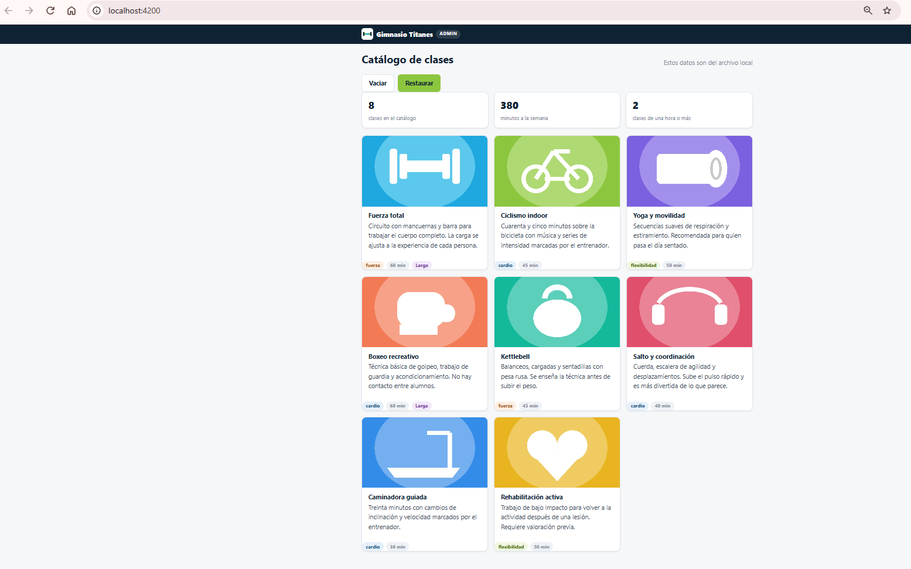
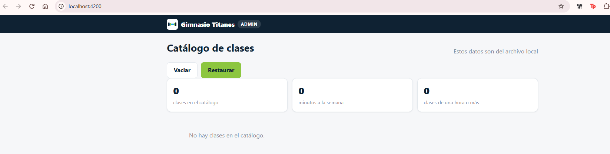
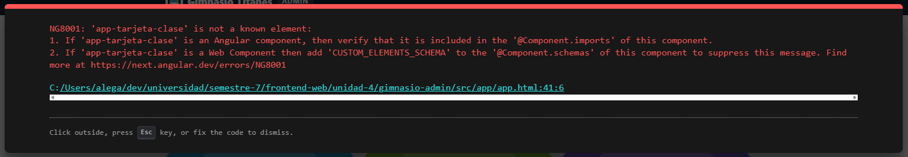
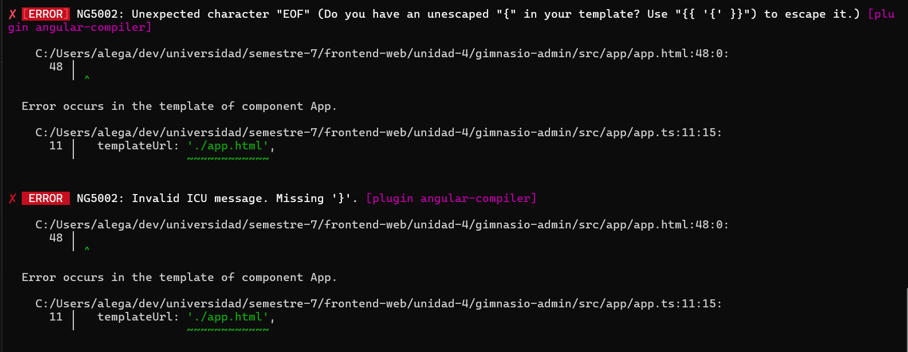
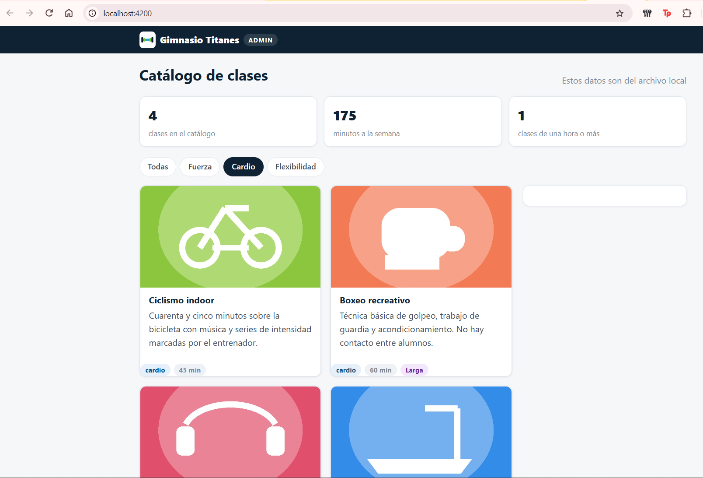
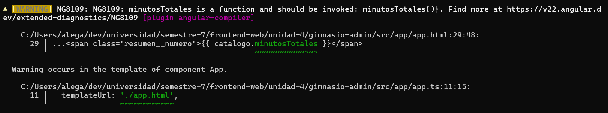

# Práctica 19 – El panel del gimnasio: el tablero en Angular

## Ejercicio 1: el proyecto y el tablero

Creé el proyecto con `ng new gimnasio-admin` sin SSR, sin router y sin pruebas, copié del código base los estilos, las imágenes, el modelo y las clases locales, y en el componente raíz puse el resumen: el total de clases (8), los minutos a la semana (380) y las clases de una hora o más (2).

### ¿Qué archivo de Angular hace el papel de main.tsx, de App.tsx y de vite.config.ts?

- `main.tsx` → `src/main.ts`. Es donde arranca la app: ahí se llama a `bootstrapApplication(App, appConfig)`, que es parecido a lo que hacía `createRoot(...).render(...)` en React.
- `App.tsx` → `src/app/app.ts`, junto con su `app.html` y su `app.css`. Es el componente raíz, el que contiene todo lo demás. En React el HTML iba dentro del mismo archivo y aquí va aparte.
- `vite.config.ts` → `angular.json`. Ahí se dice cuál es el archivo de entrada (`src/main.ts`), dónde están los estilos (`src/styles.css`) y que la carpeta `public` se sirve tal cual. Esta es la equivalencia que menos segura tengo, porque no son idénticos: lo digo por lo que cumple cada uno en el proyecto, que es la configuración de cómo se arma y se sirve la aplicación.

## Ejercicio 2: la tarjeta de una clase

Generé el componente `tarjeta-clase` con el CLI. Recibe la clase con `input.required()` y muestra su imagen, nombre, descripción, categoría y duración. La etiqueta «Larga» solo sale en las clases de 60 minutos o más (con `@if`; en mi tablero salió en Fuerza total y en Boxeo recreativo). Las tarjetas se repiten con `@for`, y cuando no hay clases sale un mensaje con `@empty`. Agregué los botones Vaciar y Restaurar.

Con el botón Vaciar, el tablero queda sin clases, con el resumen en 0 y el mensaje:

### ¿Por qué clase() lleva paréntesis y para qué sirve track?

`clase()` lleva paréntesis porque `input.required()` no regresa la clase directamente, sino una señal (signal), y para leer lo que tiene adentro hay que llamarla como si fuera una función. Si pusiera `clase.nombre` sin paréntesis, estaría buscando el nombre en la señal y no en la clase.

El `track` sirve para que Angular reconozca cuál tarjeta es cuál cuando la lista cambia. En mi `@for` uso `track clase.id`, o sea que cada tarjeta se identifica por el id de su clase. Así, si la lista cambia, Angular sabe cuáles tarjetas ya existían y no tiene que volver a armarlas todas. Esto último es lo que entendí de cómo funciona, no lo comprobé midiendo nada.

### Provocar y capturar los errores NG5002 y NG8001

**NG8001.** Quité `TarjetaClase` de los `imports` del componente raíz. Angular ya no sabe qué es `<app-tarjeta-clase>` y marca el error `NG8001: 'app-tarjeta-clase' is not a known element`, con un recuadro rojo en el navegador.

**NG5002.** Cambié `@empty` por `@vacio`, que no existe. Angular no lo reconoce como un bloque, entonces piensa que las llaves son texto suelto y marca `NG5002` (dos veces: «Unexpected character "EOF"» e «Invalid ICU message. Missing '}'»). Este error me salió en la terminal donde corre `ng serve`, pero en el navegador no salió nada: la página siguió mostrando la última versión que sí compilaba.

Después de capturar los errores, regresé el código a como estaba.

---

# Práctica 20 – El panel del gimnasio: signals, un servicio y el filtro

## Ejercicio 1: el servicio del catálogo

### ¿Qué diferencia hay entre un signal y un computed, y cuál se parece a useState y cuál a useMemo?

Un `signal` es un valor que se guarda y que se puede cambiar con `set` o `update`, por ejemplo la categoría elegida. Para leerlo hay que llamarlo con paréntesis, como `categoria()`. Un `computed` es un valor que se calcula a partir de otros signals y que no se cambia directamente, solo se lee. Por ejemplo `visibles` depende de la categoría, y `minutosTotales` depende de `visibles`, así que cuando se cambia la categoría los dos se actualizan solos.

El `signal` se parece a `useState`, porque guarda un valor que cambia. El `computed` se parece a `useMemo`, porque es un valor calculado que guarda su resultado y solo lo vuelve a calcular cuando cambia algo de lo que usa. 

## Ejercicio 2: el filtro y el detalle

Con el filtro en Cardio salen 4 clases, 175 minutos a la semana y 1 clase de una hora o más:

Con una clase elegida (Boxeo recreativo), la tarjeta se resalta y su detalle sale en el panel de la derecha:

### ¿Qué pasa si el filtro hace new Catalogo() en lugar de inject(Catalogo)?

Lo probé cambiando esa línea del filtro. Al pulsar Cardio, el botón de Cardio si se marcó como activo, pero las tarjetas del tablero no  cambiaron y los números del resumen tampoco. Pasa porque con `new Catalogo()` el filtro crea su propio catálogo, otra copia aparte, y cambia la categoría de esa copia. El tablero sigue leyendo la otra copia. Con `inject(Catalogo)` los dos componentes reciben la misma copia, y por eso lo que se hace el filtro si lo ve el tablero.

### Provocar y capturar el aviso NG8109

Le quité los paréntesis a `catalogo.minutosTotales()` en el HTML, o sea escribí `{{ catalogo.minutosTotales }}`. En la terminal de `ng serve` salió el aviso `NG8109: minutosTotales is a function and should be invoked: minutosTotales()`. Es un aviso y no un error, así que la página siguió funcionando. Lo que sí cambió fue lo que se veía en la tarjeta de minutos porque en lugar del número salió `[Computed (minutosTotales): 380]`. Sin paréntesis no se esta leyendo el valor del `computed`, sino la función misma (con el 380 adentro).

