# Práctica 19 – El panel del gimnasio: el tablero en Angular

## Ejercicio 1: el proyecto y el tablero

Creé el proyecto con `ng new gimnasio-admin` sin SSR, sin router y sin pruebas, copié del código base los estilos, las imágenes, el modelo y las clases locales, y en el componente raíz puse el resumen: el total de clases (8), los minutos a la semana (380) y las clases de una hora o más (2).

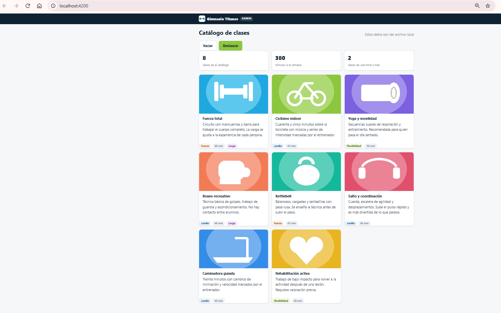

### ¿Qué archivo de Angular hace el papel de main.tsx, de App.tsx y de vite.config.ts?

- `main.tsx` → `src/main.ts`. Es donde arranca la app: ahí se llama a `bootstrapApplication(App, appConfig)`, que es parecido a lo que hacía `createRoot(...).render(...)` en React.
- `App.tsx` → `src/app/app.ts`, junto con su `app.html` y su `app.css`. Es el componente raíz, el que contiene todo lo demás. En React el HTML iba dentro del mismo archivo y aquí va aparte.
- `vite.config.ts` → `angular.json`. Ahí se dice cuál es el archivo de entrada (`src/main.ts`), dónde están los estilos (`src/styles.css`) y que la carpeta `public` se sirve tal cual. Esta es la equivalencia que menos segura tengo, porque no son idénticos: lo digo por lo que cumple cada uno en el proyecto, que es la configuración de cómo se arma y se sirve la aplicación.

## Ejercicio 2: la tarjeta de una clase

Generé el componente `tarjeta-clase` con el CLI. Recibe la clase con `input.required()` y muestra su imagen, nombre, descripción, categoría y duración. La etiqueta «Larga» solo sale en las clases de 60 minutos o más (con `@if`; en mi tablero salió en Fuerza total y en Boxeo recreativo). Las tarjetas se repiten con `@for`, y cuando no hay clases sale un mensaje con `@empty`. Agregué los botones Vaciar y Restaurar.

Con el botón Vaciar, el tablero queda sin clases, con el resumen en 0 y el mensaje:

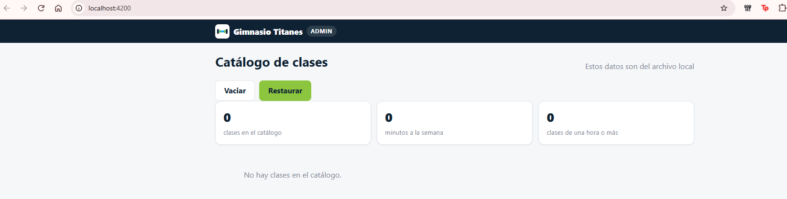

### ¿Por qué clase() lleva paréntesis y para qué sirve track?

`clase()` lleva paréntesis porque `input.required()` no regresa la clase directamente, sino una señal (signal), y para leer lo que tiene adentro hay que llamarla como si fuera una función. Si pusiera `clase.nombre` sin paréntesis, estaría buscando el nombre en la señal y no en la clase.

El `track` sirve para que Angular reconozca cuál tarjeta es cuál cuando la lista cambia. En mi `@for` uso `track clase.id`, o sea que cada tarjeta se identifica por el id de su clase. Así, si la lista cambia, Angular sabe cuáles tarjetas ya existían y no tiene que volver a armarlas todas. Esto último es lo que entendí de cómo funciona, no lo comprobé midiendo nada.

### Provocar y capturar los errores NG5002 y NG8001

**NG8001.** Quité `TarjetaClase` de los `imports` del componente raíz. Angular ya no sabe qué es `<app-tarjeta-clase>` y marca el error `NG8001: 'app-tarjeta-clase' is not a known element`, con un recuadro rojo en el navegador.

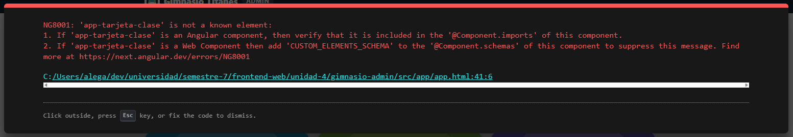

**NG5002.** Cambié `@empty` por `@vacio`, que no existe. Angular no lo reconoce como un bloque, entonces piensa que las llaves son texto suelto y marca `NG5002` (dos veces: «Unexpected character "EOF"» e «Invalid ICU message. Missing '}'»). Este error me salió en la terminal donde corre `ng serve`, pero en el navegador no salió nada: la página siguió mostrando la última versión que sí compilaba.

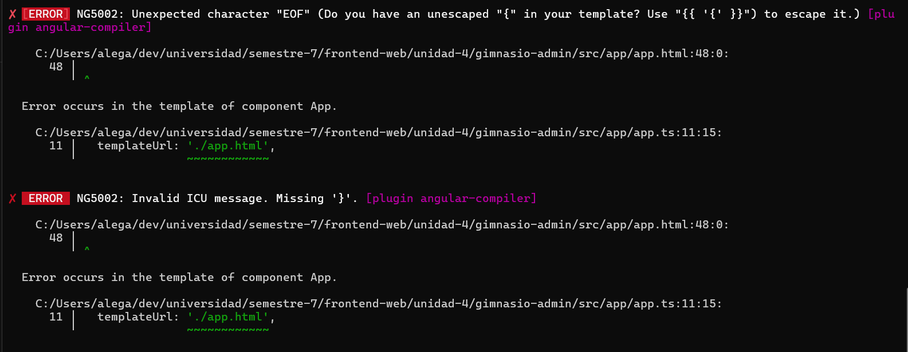

Después de capturar los errores, regresé el código a como estaba.

---

# Práctica 20 – El panel del gimnasio: signals, un servicio y el filtro

## Ejercicio 1: el servicio del catálogo

### ¿Qué diferencia hay entre un signal y un computed, y cuál se parece a useState y cuál a useMemo?

Un `signal` es un valor que se guarda y que se puede cambiar con `set` o `update`, por ejemplo la categoría elegida. Para leerlo hay que llamarlo con paréntesis, como `categoria()`. Un `computed` es un valor que se calcula a partir de otros signals y que no se cambia directamente, solo se lee. Por ejemplo `visibles` depende de la categoría, y `minutosTotales` depende de `visibles`, así que cuando se cambia la categoría los dos se actualizan solos.

El `signal` se parece a `useState`, porque guarda un valor que cambia. El `computed` se parece a `useMemo`, porque es un valor calculado que guarda su resultado y solo lo vuelve a calcular cuando cambia algo de lo que usa. 

## Ejercicio 2: el filtro y el detalle

Con el filtro en Cardio salen 4 clases, 175 minutos a la semana y 1 clase de una hora o más:

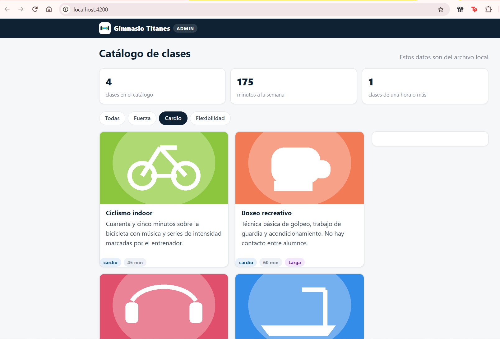

Con una clase elegida (Boxeo recreativo), la tarjeta se resalta y su detalle sale en el panel de la derecha:

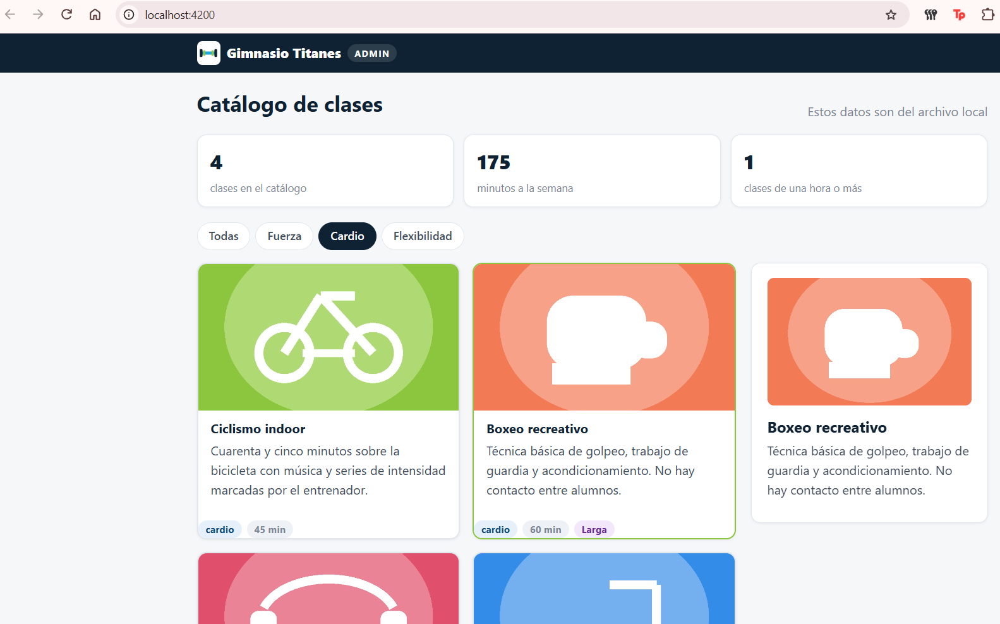

### ¿Qué pasa si el filtro hace new Catalogo() en lugar de inject(Catalogo)?

Lo probé cambiando esa línea del filtro. Al pulsar Cardio, el botón de Cardio si se marcó como activo, pero las tarjetas del tablero no  cambiaron y los números del resumen tampoco. Pasa porque con `new Catalogo()` el filtro crea su propio catálogo, otra copia aparte, y cambia la categoría de esa copia. El tablero sigue leyendo la otra copia. Con `inject(Catalogo)` los dos componentes reciben la misma copia, y por eso lo que se hace el filtro si lo ve el tablero.

### Provocar y capturar el aviso NG8109

Le quité los paréntesis a `catalogo.minutosTotales()` en el HTML, o sea escribí `{{ catalogo.minutosTotales }}`. En la terminal de `ng serve` salió el aviso `NG8109: minutosTotales is a function and should be invoked: minutosTotales()`. Es un aviso y no un error, así que la página siguió funcionando. Lo que sí cambió fue lo que se veía en la tarjeta de minutos porque en lugar del número salió `[Computed (minutosTotales): 380]`. Sin paréntesis no se esta leyendo el valor del `computed`, sino la función misma (con el 380 adentro).

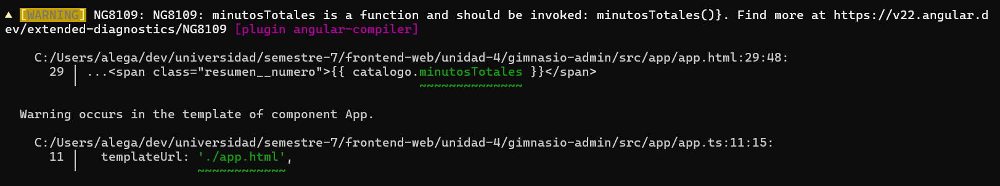

---

# Práctica 21 – El panel del gimnasio: rutas, la API y eliminar

## Ejercicio 1: el router y las páginas

En la página Horarios sale su «hola mundo» y su enlace se pinta de verde en la barra:

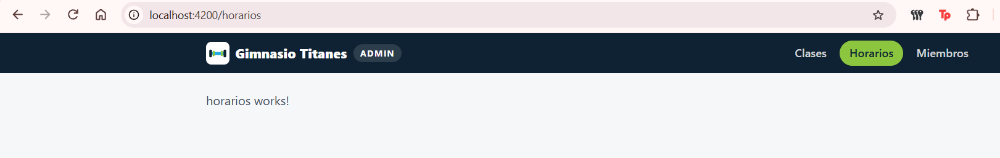

### ¿Qué pieza de React Router corresponde a router-outlet, a routerLink y a routerLinkActive?

- `router-outlet` a `<Outlet />`. Es el lugar donde se pinta la página que toca según la dirección.
- `routerLink` a `<Link to="...">`. Sirve para cambiar de página sin que se recargue todo el navegador. 
- `routerLinkActive` a `<NavLink>`. En React, `NavLink` sabe si su enlace es el de la página actual para ponerle un estilo de activo. 

### ¿Por qué la ruta comodín (**) va al final y la ruta vacía necesita pathMatch: 'full'?

La comodín `**` va al final porque Angular revisa las rutas en orden, de arriba hacia abajo, y se queda con la primera que le queda. Como `**` le queda a cualquier dirección, si la pusiera arriba se quedaría con todas y nunca se llegaría a `/horarios` ni a `/miembros`. 

La ruta vacía necesita `pathMatch: 'full'` porque si no se pone, Angular revisa si la dirección *empieza* con esa ruta, y todas las direcciones empiezan con un texto vacío. Entonces todo se redirigiría a `/clases`. Con `'full'` solo redirige cuando la dirección está vacía completa.

## Ejercicio 2: el formulario de nueva clase

Al darle Guardar con el formulario vacío salen en rojo los mensajes del nombre, la duración y la descripción:

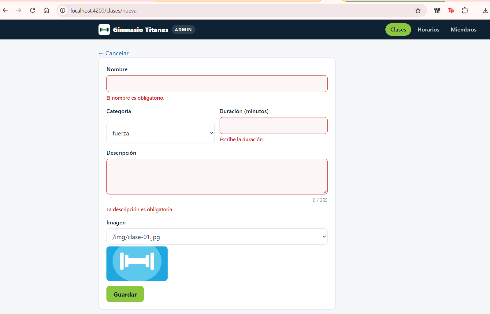

Con 47 minutos sale el mensaje del validador propio:

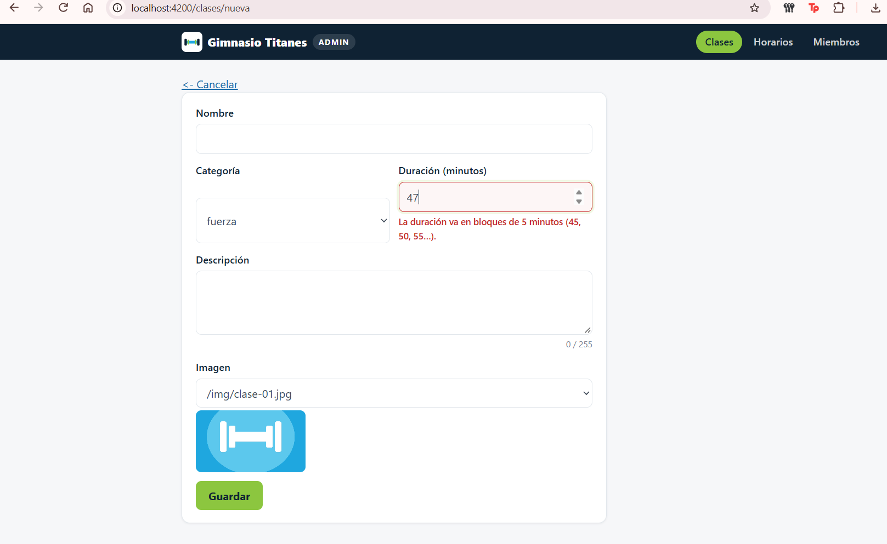

Con el formulario válido, al guardar sale el aviso con el objeto que se mandaría a la API (todavía no se manda nada):

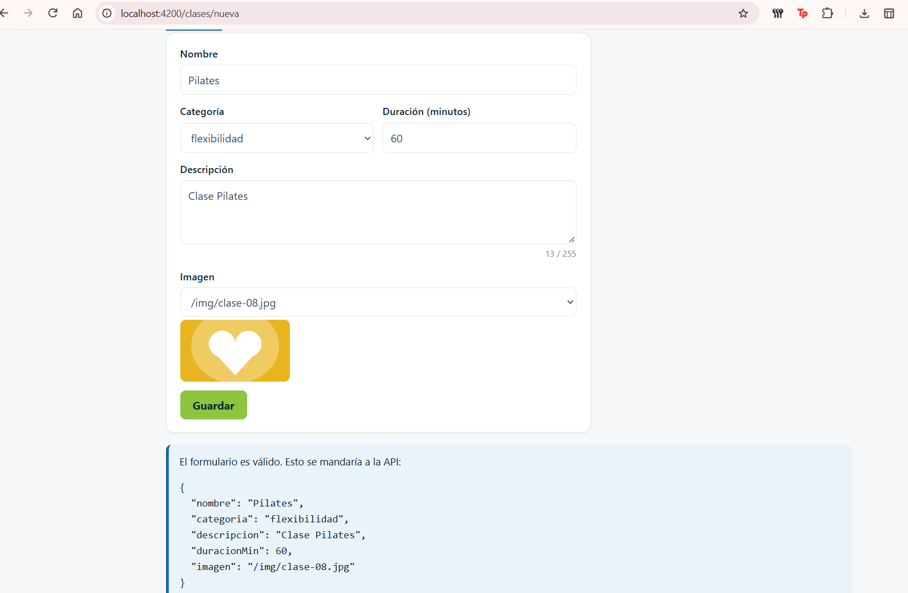

### ¿Dónde vive el valor de un campo en un formulario reactivo y en qué se diferencia del useState de React?

El valor vive en el `.ts`, dentro del `form` en `FormBuilder`. Cada campo es un control y ahí está su valor (`f.nombre.value`), si ya fue tocado y qué errores tiene. 

En React con `useState` se tiene que hacer un estado por cada campo y ponerle a cada input su `value` y su `onChange` para irlo actualizando a mano.

### ¿Qué regresa un validador propio cuando el valor es válido y cuando no, y cómo se relaciona con hasError?

Cuando el valor es válido regresa `null`, o sea no hay valor. Cuando no es válido regresa un objeto con el nombre del error. En mi `multiploDe(5)`, con 47 regresa `{ multiploDe: { n: 5, valor: 47 } }`.

`hasError('multiploDe')` revisa si en los errores del campo está ese nombre. Si el validador regresó el objeto, da `true` y sale el mensaje «La duración va en bloques de 5 minutos», si regresó `null`, da `false` y no sale nada.

## Ejercicio 3: el catálogo desde la API

El catálogo ya pide las clases a la API. En la pestaña Red sale `GET /clases` con 200, y las imágenes también vienen de la API:

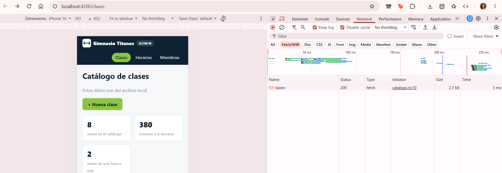

### ¿Qué cambió en el servicio del catálogo y por qué ningún componente se enteró?

Cambió de dónde salen las clases. Antes `clases` era un `signal` con `CLASES_LOCALES`, y ahora es un `computed` que saca los datos de un `httpResource` que pide `GET /clases`.

Ningún componente se enteró porque lo que ellos leen del servicio se quedó igual, tienen el mismo nombre y regresan lo mismo, así que al filtro y a la tarjeta no les importa si las clases vienen de un archivo o de la API.

### ¿Por qué no hizo falta iniciar sesión para leer el catálogo?

Porque en el backend `GET /clases` es público. Así que la API contesta aunque la petición no lleve token.

---

# Práctica 22 – El panel del gimnasio: crear y editar clases

## Ejercicio 1: guardar con POST

Quité los Validators de nombre y duración, y con el nombre vacío y 5 minutos el POST sí salió. El servidor respondió 400 y arriba del formulario salieron sus mensajes:

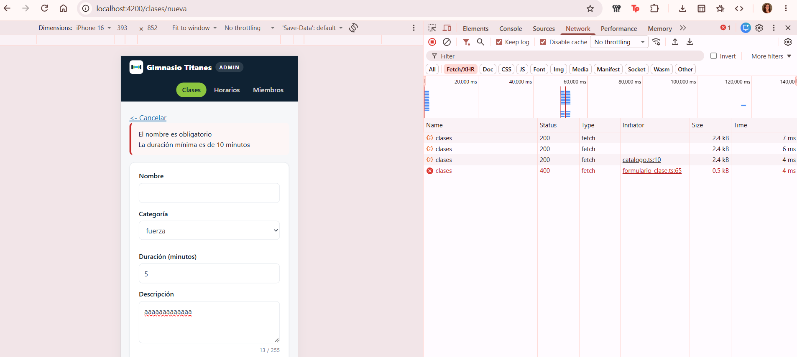

Con `@Roles(Rol.admin)` de vuelta en el backend, y todavía sin login, el POST responde 401:

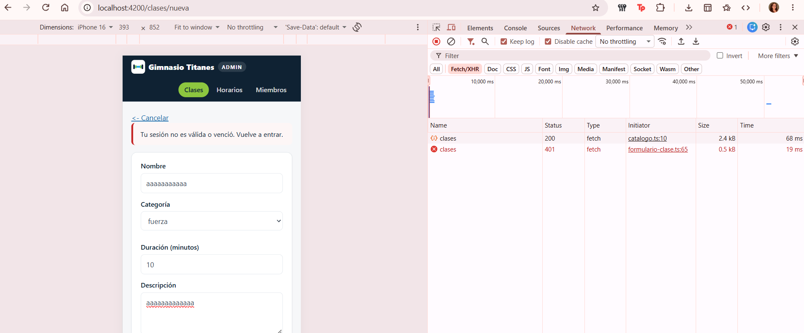

### Si el formulario ya valida, ¿por qué también valida el servidor?

Porque lo que se valida en el navegador se puede saltar. Cualquiera puede cambiar el código del navegador o mandar la petición desde otro lado sin usar mi formulario. La validación del formulario es para que el usuario vea el error rápido, sin esperar a la API, pero la que de verdad protege los datos es la del servidor.

### ¿Por qué httpResource para leer y HttpClient para crear, editar y eliminar?

`httpResource` hace la petición solo, en cuanto se crea, y me da el resultado, el «cargando» y el error ya como signals. Crear, editar y eliminar no deben pasar solos, tienen que pasar una vez y solo cuando le doy clic a Guardar. Con `HttpClient` yo decido cuándo sale la petición (con el `subscribe()`) y qué hacer cuando termina.

### ¿Qué pasa si se olvida el subscribe()?

La petición nunca sale. `this.http.post(...)` solo prepara la petición, pero no la manda hasta que alguien le hace `subscribe()`.

## Ejercicio 2: el login, los interceptores y el guardia

Con la cuenta de miembro (`karla@itson.mx`) el login no deja entrar al panel:

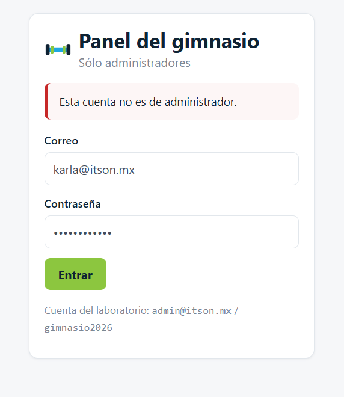

Ya con la sesión del admin, el POST sale con el encabezado `Authorization` y la API responde 201:

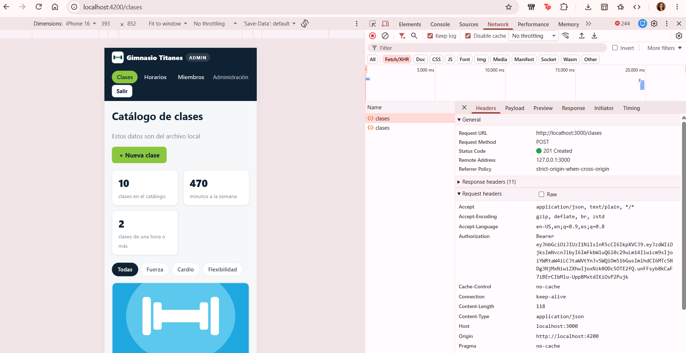

### ¿A qué pieza de React corresponden las rutas hijas (children), el interceptor y el guardia?

- Las rutas hijas (`children`) son las rutas anidadas de React Router dentro de una ruta con `<Layout>`.
- El interceptor es como el interceptor de Axios (`api.interceptors.request.use` y `api.interceptors.response.use`).
- El guardia es como el componente `<RutaProtegida>`: si no hay sesión de admin manda al login (como `<Navigate to="/login" />`) y si sí la hay deja pasar.

### ¿Cuándo se ejecuta el guardia y por qué salir() tiene que navegar al login?

El guardia se ejecuta cuando intento entrar a la ruta del panel, por ejemplo cuando escribo `/clases` en la barra, recargo la página o el login me manda a `/clases`.

Por eso `salir()` tiene que navegar al login: si solo borrara la sesión, me quedaría en la página donde estaba porque nadie vuelve a revisar al guardia. Al navegar al login si salgo del panel, y si después intento regresar a `/clases`, el guardia ya no me deja y me manda al login.

## Ejercicio 3: editar, eliminar y la guarda de salida

Al editar una clase y guardar, sale un PATCH a `/clases/1` con 200 y el catálogo se actualiza:

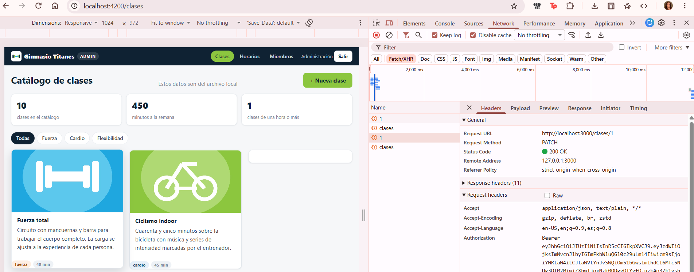

Al eliminar una clase (después de confirmar), sale un DELETE con 200 y el catálogo queda con una clase menos:

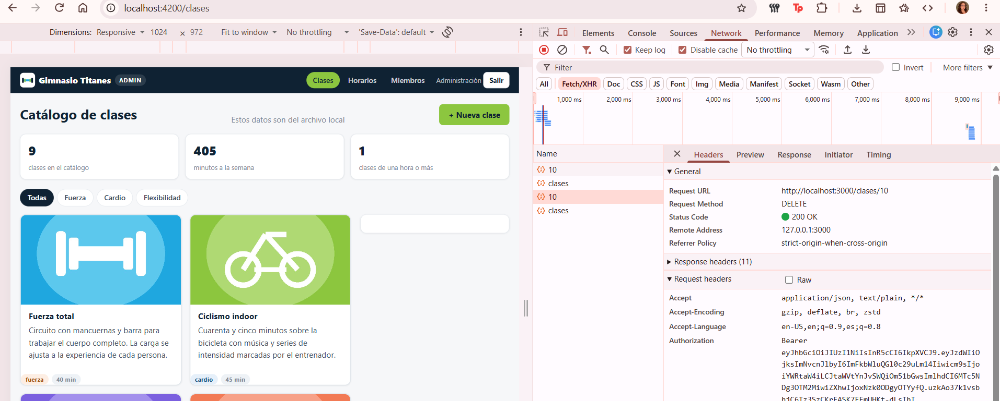

Si escribo algo en el formulario y trato de salir, la guarda de salida pide confirmación:

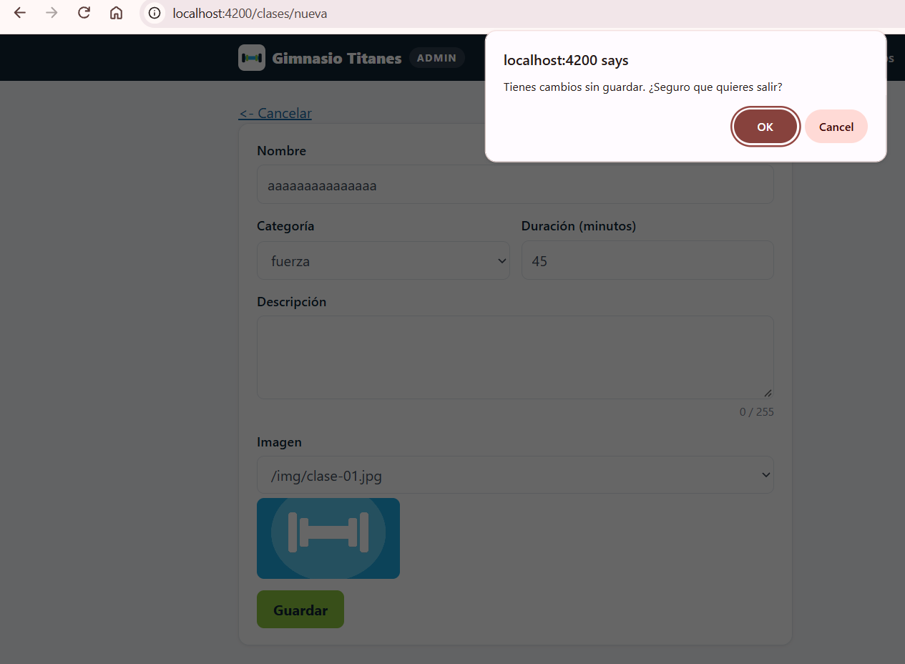

### ¿Cómo decide un mismo formulario, con dos rutas, si manda POST o PATCH?

Por el `id`. Las dos rutas (`clases/nueva` y `clases/:id/editar`) cargan el mismo `FormularioClase`, pero solo la de editar trae un `:id` en la dirección, y ese id le llega al formulario como `input`. En `guardar()` reviso y si hay `id` uso `actualizar()` (PATCH), y si no hay uso `crear()` (POST).

### ¿Por qué el estado del formulario no se puede observar con un computed()?

Porque un `computed()` solo se vuelve a calcular cuando cambia un signal que lee, y el estado del formulario reactivo no es un signal. Entonces si meto `form.dirty` en un `computed()`, no se entera cuando escribo en un campo.

### ¿Qué diferencia hay entre canActivate y canDeactivate, y qué casos no cubre la guarda de salida?

`canActivate` se revisa antes de **entrar** a una ruta, como `soloAdmin`, que no deja entrar al panel sin sesión de admin. `canDeactivate` se revisa antes de **salir** de una ruta, como `cambiosSinGuardar`.

La guarda de salida solo funciona cuando me muevo con el router de Angular (el «Cancelar», los enlaces de la barra). Lo probé y no cubre cuando recargo la página ni cuando cierro la pestaña.

### ¿Por qué la ruta de crear va antes que la del id?

Porque el router revisa las rutas en orden y `clases/:id` le queda a cualquier cosa que venga después de `clases/`, incluida la palabra «nueva». Lo probé poniendo la ruta del detalle arriba: al darle «+ Nueva clase» me abrió la página de detalle en lugar del formulario, pidió `GET /clases/NaN` (porque tomó «nueva» como si fuera el id) y el servidor respondió 400 con «Validation failed (numeric string is expected)». Con `clases/nueva` arriba, esa dirección exacta se encuentra primero y ya no se confunde con un id.

# Práctica 23 – El panel del gimnasio: el buscador con RxJS

## Ejercicio 1: el tubo de búsqueda

### ¿Qué diferencia hay entre un signal y un Observable?

Un signal siempre tiene un valor guardado y lo puedo leer cuando quiera con `()`, por ejemplo `cargando()`. Un Observable no guarda nada y para recibirlos me tengo que suscribir. 

## Ejercicio 2: la caja de búsqueda

Al escribir «yoga» de corrido sale una sola petición, `clases?q=yoga`, gracias al `debounceTime`:

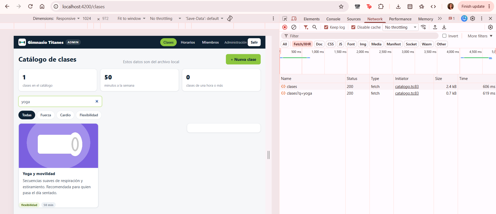

Con `RETARDO_MS` en el backend, si escribo otra letra mientras la petición anterior no ha regresado, esa petición sale como «(canceled)» y solo la última llega con 200:

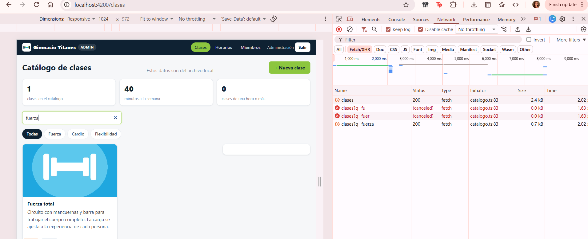

Cuando ninguna clase coincide sale el mensaje de que no hay clases:

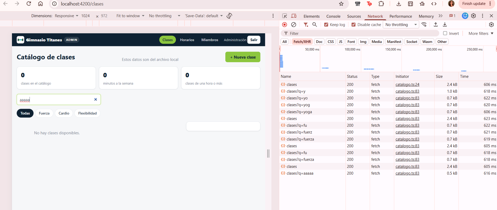

Si muevo el tubo del buscador del constructor a `ngOnInit()`, sale el error NG0203, porque `takeUntilDestroyed()` solo se puede usar en el constructor:

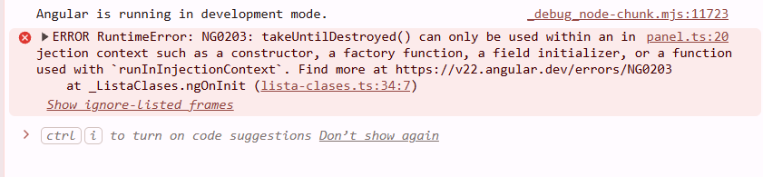

### ¿Qué problema evita switchMap y qué pasaría con mergeMap?

`switchMap` evita que una respuesta vieja tape a una nueva. Cuando llega un texto nuevo, cancela la petición anterior que todavía no regresaba y se queda solo con la última, como se ve en la captura de las canceladas. Con `mergeMap` no se cancela nada y todas las peticiones siguen vivas y cada respuesta se pinta cuando llega. 

### ¿Qué pasa si se quita catchError y la API se apaga?

Lo probé, quité el `catchError`, apagué el backend y escribí «yoga». Ya no salió el aviso rojo de error, la página se quedó en «buscando...» con los esqueletos grises, y en la consola salieron varios errores `HttpErrorResponse` con status 0. O sea, el error ya no se convierte en un mensaje para la pantalla, sino que truena. 
